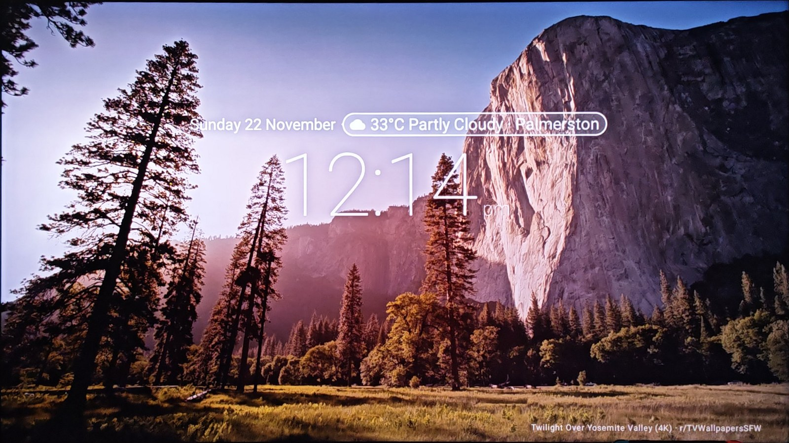
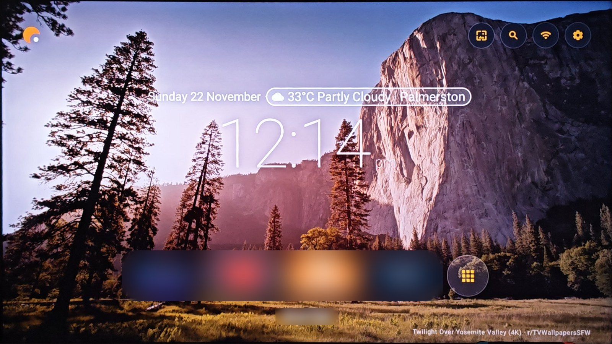

# FireLauncher

A clean, ad-free home screen for **Amazon Fire TV**. Your wallpaper fills the screen, with a big clock, the weather and a dock of your favourite apps. No sponsored rows.

Built with Kotlin and Jetpack Compose for TV. Fire OS 6, 7 and 8 (Android 7.1+).

**[Download the latest release →](https://github.com/knightmstr/Fire-Launcher/releases/latest)**

<table>
  <tr>
    <td></td>
    <td></td>
  </tr>
  <tr>
    <td align="center"><sub>The <b>Clean</b> layout: just the clock, date and weather over your wallpaper</sub></td>
    <td align="center"><sub>Press any button and your apps and the top bar appear, then fade away again</sub></td>
  </tr>
</table>

---

## Features

**Home**
- Wallpaper-first layout: date, weather and a big clock in the middle, a dock of favourites at the bottom
- Two home layouts: **Dock** (favourites always at the bottom) or **Clean** (only the clock and wallpaper; any button brings the apps back, and they fade away after a few seconds)
- Wallpapers from your own photos (default) or r/TVWallpapersSFW, changing on a timer you choose
- Live weather for any city (Open-Meteo, no account), °C / °F
- Now playing: app, title and ⏮ ⏯ ⏭ for whatever's playing in Spotify, YouTube, Plex…

**Apps**
- All Apps grid with search (the on-screen keyboard opens straight away) and voice search from the remote's mic button
- Sort A–Z, most recent, most used, or your own order
- Hold OK (or ☰) on any app to favourite, reorder, rename, hide, or open App info
- Tile size slider and tile shapes (rounded, square, extra rounded, pill)

**Fire TV**
- Home button opens FireLauncher instead of Amazon's home
- FireLauncher's screensaver replaces Amazon's, with the same wallpaper, clock and weather
- Optional keep-awake, so the Fire TV doesn't sleep on a timer
- Wi-Fi and Fire TV settings one press away, opening Fire OS's own screens

**Family & upkeep**
- Kids mode: only the apps you allow, PIN to leave
- Updates itself from GitHub Releases (checksum-verified; you confirm every install)

---

## Install

You need adb once: from a computer, or from your Android phone with **Termux** (`pkg install android-tools wget`).

1. On the Fire TV, go to **Settings → My Fire TV → About** and press OK on the device name 7 times to unlock Developer options. Then turn on **Developer options → ADB debugging**.
2. Find the TV's IP address in **Settings → My Fire TV → About → Network**.
3. Install:

```bash
adb connect <TV-IP>:5555          # accept the prompt on the TV
wget https://github.com/knightmstr/Fire-Launcher/releases/download/<version>/FireLauncher-<version>-release.apk
adb install -r FireLauncher-<version>-release.apk
adb shell am start -n com.knightmstr.firelauncher/.MainActivity
```

Replace `<version>` with the latest tag, e.g. `v1.3.1`. After this, new versions install from the TV: an **Update** button appears at the top of the home screen.

---

## One-time extras

These are optional.

**Home button, screensaver and keep-awake.** FireLauncher needs a one-time permission to change these Fire TV settings. Turning an option off puts Amazon's setting back.

*On the TV, no phone needed:*

1. Turn on **ADB debugging**: Settings → My Fire TV → Developer options. If Developer options is missing, go to My Fire TV → About and press OK on your device name 7 times.
2. In FireLauncher, open **⚙ → Launcher settings** and choose one of the three options (under *Screensaver* and *Fire TV*), then **Set up on this TV**.
3. The TV asks *Allow USB debugging?* Tick **Always allow** and press **OK**. The option turns on.

FireLauncher connects to the TV's own ADB, only to grant itself this permission. You can leave ADB debugging on or turn it off afterwards; the permission stays until you uninstall.

*Or from a phone (Termux) or computer:*

```bash
adb shell pm grant com.knightmstr.firelauncher android.permission.WRITE_SECURE_SETTINGS
```

Either way, then switch them on in **⚙ → Launcher settings**: *Home button opens FireLauncher*, *Use as Fire TV screensaver* and *Keep Fire TV awake*. The grant alone changes nothing until you do. On Fire OS 8, restart once after turning on the screensaver.

Check it worked: `adb shell settings get secure sleep_timeout` shows `-1` with keep-awake on, and `adb shell settings get secure screensaver_components` names FireLauncher. If the TV shows *No signal* when the screensaver should be on, keep-awake isn't on yet.

**Now playing.** Many Fire TVs hide the notification-access screen:

```bash
adb shell cmd notification allow_listener com.knightmstr.firelauncher/com.knightmstr.firelauncher.media.MediaListenerService
```

**Your own wallpapers.** Copy photos straight in, with no permission needed:

```bash
adb push photo.jpg /sdcard/Android/data/com.knightmstr.firelauncher/files/Pictures/
```

Photos in an album called **FireLauncher** also work, after *Allow photo access* in Launcher settings.

---

## Remote

| Button | What it does |
|---|---|
| **OK** | Open the app |
| **Hold OK** or **☰** | App options: favourite, move, rename, hide, Kids mode, App info |
| **Mic** | Voice search |
| **Back** | Closes menus and search (never leaves the launcher) |
| **⚙** (top right) | Launcher settings or Fire TV settings |

In settings, sliders move with **◀ ▶**, and every other row changes with **OK**.

---

## Good to know

- **Amazon's home may flash** for a moment when you press Home, before FireLauncher comes back. Fire OS doesn't allow avoiding this without rooting.
- **Kids mode locks the launcher, not the device.** For device-wide limits, also use *Settings → Preferences → Parental Controls*.
- **When the screensaver starts** inside other apps follows Fire TV's *Display & Sounds → Screensaver → Start Time*.
- **Updates install over each other** only when they're signed with the same key, which is how the official releases are signed.

---

## Permissions & privacy

| Permission | Why |
|---|---|
| Internet | Weather (Open-Meteo), Reddit wallpapers, update checks (GitHub) |
| Photos | Only for your **FireLauncher** album, if you allow it |
| Install packages | Installing updates; Android asks you every time |
| Start at boot | Re-applying your Home button and screensaver choices after a restart |
| Secure settings | Only after you grant it, on the TV or with adb (see above); every change can be undone |
| Accessibility (Home button) | Only sees which **Amazon launcher** screen opened, never screen content |
| Notification access (Now playing) | Only reads what's playing; never reads notifications |

There's no analytics or tracking, and no accounts. Network traffic is HTTPS only.

---

## Debloat (optional)

[`AI_STEPS.md`](AI_STEPS.md) is a step-by-step guide you can follow yourself or hand to an AI coding agent (Claude Code, Gemini CLI…). It installs FireLauncher and disables five Amazon ad and telemetry services. Everything can be undone.

<details>
<summary>The commands</summary>

```bash
# Disable
for p in com.amazon.advertising.firetv com.amazon.device.sale.service \
         com.amazon.client.metrics com.amazon.device.crashmanager com.amazon.ftv.screensaver; do
  adb shell pm disable-user --user 0 "$p"
done

# Undo
for p in com.amazon.advertising.firetv com.amazon.device.sale.service \
         com.amazon.client.metrics com.amazon.device.crashmanager com.amazon.ftv.screensaver; do
  adb shell pm enable "$p"
done
```

</details>

---

## Build from source

JDK 17 and Android SDK 34.

```bash
./gradlew assembleDebug        # app/build/outputs/apk/debug/
./gradlew testDebugUnitTest    # unit tests
```

<details>
<summary>Releases & signing</summary>

- **CI** (`.github/workflows/android-ci.yml`) runs the unit tests, lint and both builds on every push and pull request to `main`.
- **Releases** (`.github/workflows/release.yml`): push a `vX.Y.Z` tag, or run the workflow by hand with a version. It builds the signed release APK, a debug APK and a SHA-256 checksum file, and publishes a GitHub Release. The version code is `MAJOR×10000 + MINOR×100 + PATCH`.
- **Signing**: add the repository secrets `KEYSTORE_BASE64`, `KEYSTORE_PASSWORD`, `KEY_ALIAS` and `KEY_PASSWORD`. Without them, releases use a throwaway debug key, and updates then can't install over each other.
- **Forks**: set `UPDATE_REPO` in `app/build.gradle.kts` so the in-app updater checks your releases.

</details>

<details>
<summary>Project layout</summary>

```
app/src/main/java/com/knightmstr/firelauncher/
├── data/          apps, preferences, wallpapers, weather, Kids-mode PIN
├── home/          Home button watcher (accessibility service)
├── screensaver/   system screensaver + Fire TV screensaver/sleep settings
├── media/         Now playing (media sessions)
├── update/        GitHub update check, download, verify, install
└── ui/            Compose screens: home, dock, All Apps, dialogs, settings
tools/             get_tv_ip.py, clear_launcher_cache.sh (used by AI_STEPS.md)
```

</details>

---

## Credits

- [couch-tv](https://github.com/Seagey/couch-tv) (MIT): home layout, Home button watcher and Fire TV settings approach
- [CleanYourTV](https://github.com/Gathin23/cleanyourtv): debloat workflow inspiration
- [dadb](https://github.com/mobile-dev-inc/dadb) (Apache 2.0): ADB key format and signing for on-TV setup
- [Open-Meteo](https://open-meteo.com): weather and city search
- [r/TVWallpapersSFW](https://www.reddit.com/r/TVWallpapersSFW): optional wallpapers
