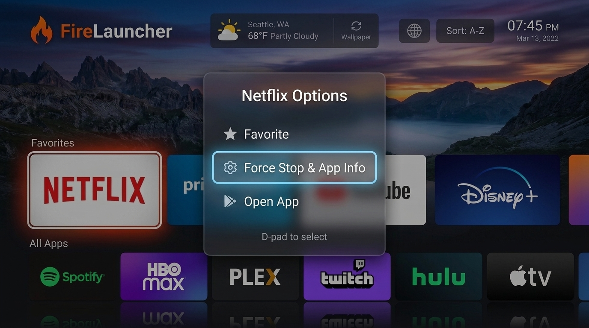

# FireLauncher 🔥

A high-performance custom home-screen launcher designed specifically for **Amazon Fire TV (Fire OS)**, built in Kotlin using **Jetpack Compose for TV (tv-material)**, **MVVM architecture**, **Preferences DataStore**, and **AndroidX Palette** for dynamic ambient theming.

<p align="center">
  
  <br/>
  <em>FireLauncher on Fire TV: Dynamic 4K wallpaper, live Open-Meteo weather, A–Z / Recent / Frequent sorting, and D-pad App Options menu (Force Stop / App Info & Favorites)</em>
</p>

---

## 📺 Key Features

1. **Dual Leanback & Standard App Scanner**:
   - Queries both `android.intent.category.LEANBACK_LAUNCHER` and `android.intent.category.LAUNCHER`.
   - Android 11+ (API 30+) `<queries>` visibility support.
   - De-duplicates by package name (preferring Leanback entries for 16:9 TV banners).
   - Excludes self and sorts alphabetically A–Z.
   - Launches apps with explicit `ComponentName` intents and `FLAG_ACTIVITY_NEW_TASK`.
2. **Dynamic Ambient Background Gradients**:
   - Uses AndroidX `Palette` to extract vibrant accent colors from app banners or icons.
   - Clamps HSV saturation (`0.55`–`0.95`) and value/brightness (`0.50`–`0.88`) to guarantee vivid, legible colors that never become washed-out or near-black.
   - Animated background gradient dynamically transitions to the focused card's accent color.
3. **Custom Fire TV D-Pad Focus Behavior**:
   - 16:9 rounded cards built on `androidx.tv.material3.Surface`.
   - On D-pad focus: card scales to **1.12x**, gains a crisp **2dp white border**, and emits an **accent-color tinted glow**.
   - Focus defaults to the first card on application launch.
4. **Clean Home Screen & All Apps Grid**:
   - Home shows an **All Apps** tile, your Favorites and the System row, so everything fits on one screen.
   - The tile opens a full-screen grid of every app that wraps to the screen width (Back closes it, Sort button cycles the order). Prefer the old row? *Launcher Settings → Show All Apps row on home*.
   - **App card size** (Small / Medium / Large) in Launcher Settings; Small is the default.
4b. **App Options Menu (hold OK, or press ☰ on the remote)**:
   - **Favorites**: add/remove, and **Move left / Move right** to reorder the Favorites row (the menu stays open so you can nudge several places).
   - **Rename** any app (e.g. "Prime Video" → "Prime"); restore the original name at any time. Search still matches the original name.
   - **Hide** apps you never use from All Apps and Favorites. Turn on *Show hidden apps row* in Launcher Settings to see and unhide them.
   - **Move in All Apps** arranges your own app order (the first move switches the sort to *My Order*; new apps appear at the end A–Z).
   - **Add as Quick button**: up to 5 round one-press shortcuts in the header.
   - **Allow in Kids mode** picks which apps kids can see.
   - **Force Stop & App Info** opens the Fire OS app settings page.
   - Favorited cards show a yellow dot; everything is saved in Preferences DataStore.
5. **System Shortcuts Row & Launcher Settings**:
   - 1-click access to **Wi-Fi**, **Display**, **Sound**, **Bluetooth** and **All Settings**.
   - **Launcher Settings** tile: wallpaper rotation interval (15 min – 3 hr or never), screensaver timeout (5–30 min or off), °C/°F, and the hidden-apps row. Every option cycles with OK — no keyboard needed.
6. **Kids Mode**:
   - Turn on in Launcher Settings once you've allowed some apps. Only those apps appear; hidden apps, system shortcuts and the options menu are locked away.
   - Leaving Kids mode needs a 4-digit PIN entered on an on-screen keypad (salted SHA-256, never stored in plain text; 30 s lockout after 5 wrong tries).
   - This locks the launcher only. For device-wide limits also use Fire OS **Settings → Preferences → Parental Controls**.
7. **Your Own Photos as Wallpapers (default)**:
   - Put photos in an album/folder named **FireLauncher** (e.g. `Pictures/FireLauncher`) and allow photo access in Launcher Settings, **or** push them with no permission needed:
     ```bash
     adb push holiday.jpg /sdcard/Android/data/com.knightmstr.firelauncher/files/Pictures/
     ```
   - Photos load from local storage — no wallpaper downloads at all. If none are found it falls back to Reddit; you can also pick Reddit explicitly in Settings.
8. **Now Playing Controls**:
   - Shows what's playing (Spotify, YouTube, Plex…) with previous / play-pause / next in the header. Hold play-pause to jump back into the app.
   - Needs one-time notification access (FireLauncher never reads notifications; Android requires it to see media sessions). Many Fire OS builds hide that screen, so grant it over ADB:
     ```bash
     adb shell cmd notification allow_listener com.knightmstr.firelauncher/com.knightmstr.firelauncher.media.MediaListenerService
     ```
   - Only listens while the launcher is on screen.
9. **In-App Updates from GitHub Releases**:
   - Checks `knightmstr/Fire-Launcher` releases 20 s after start and every 12 h. When a newer version exists, an **Update** chip appears in the header (also under Launcher Settings → App updates).
   - **Download & install** fetches the `-release.apk`, verifies its SHA-256 against the release's checksum file, checks it's FireLauncher and newer, then hands it to Android's installer. You always confirm on Android's own screen.
   - One-time setup: allow FireLauncher under **Install unknown apps** (the dialog links there; on Fire OS it's *Settings → My Fire TV → Developer options → Install unknown apps*).
   - Updates only install if signed with the same key, which is why releases need the `KEYSTORE_*` secrets. Forks: change `UPDATE_REPO` in `app/build.gradle.kts`.
10. **Idle Screensaver**:
   - After the chosen idle time, shows a dimmed wallpaper slideshow with a large clock, date and temperature.
   - The clock drifts to a new position every minute to avoid screen burn-in. Any remote button wakes it without triggering an action.
   - The launcher no longer holds `FLAG_KEEP_SCREEN_ON`, so Fire OS's own sleep timer still works.
11. **r/TVWallpapersSFW Wallpapers (optional source) Homepage Wallpapers & Vivid Glass Scrim**:
   - Fetches authentic 16:9 high-resolution landscape TV wallpapers directly from `r/TVWallpapersSFW`.
   - Rotates automatically (every **30 minutes** by default, configurable in Launcher Settings) with smooth Coil image crossfading.
   - **Enhanced Wallpaper Visibility**: Replaced heavy opaque masks with an ultra-clear, translucent glass scrim (12%–52% gradient). Wallpapers are now bright, vivid, and cinematic across the entire screen while maintaining 100% text/card legibility with subtle drop shadows.
   - Includes a discreet top-right attribution chip showing the wallpaper title and source subreddit.
   - Top bar "Next Wallpaper" button allows manual instant cycling.
   - Built-in curated 4K fallback wallpapers ensure seamless operation even offline or in network-restricted environments.
12. **Library 'Sort By' Menu (A–Z, Most Recent, Most Frequent)**:
   - Dynamic sorting modal dialog accessible from the Top Bar ("Sort" button / `S` key) and directly on the "All Apps" row header (`Sorted by: ... ▾`).
   - Three automatic sort orders, plus **My Order** (arranged by you via *Move in All Apps*):
     - **Alphabetical (A–Z)**: Classic alphabetical ordering by application title.
     - **Most Recently Used (MRU)**: Orders apps by latest launch timestamp, showing friendly relative time badges (e.g. *"5m ago"*, *"2h ago"*).
     - **Most Frequently Used (MFU)**: Orders apps by total launch frequency, showing play count badges (e.g. *"24×"*).
   - Tracks app launches and saves sorting preferences persistently in Preferences DataStore (`KEY_APP_SORT_ORDER` and `KEY_APP_USAGE_STATS`).
13. **Accurate Live Weather with Global City Search (Open-Meteo API)**:
   - Replaces mock weather with real-time meteorological forecasts powered by **Open-Meteo** (free, no API key required, WMO weather standards).
   - Shows live temperature, weather condition icon/summary, high/low, humidity %, and wind speed.
   - **Global City Search Modal**: Users can search for any city in the world using Open-Meteo Geocoding, view region/country, and add it with one click.
   - Custom cities are saved persistently in AndroidX Preferences DataStore.
   - Quick toggle between **Fahrenheit (°F)** and **Celsius (°C)**; defaults to °C everywhere except the US.
14. **Top Bar, Global App Search & Live Clock**:
   - Dedicated **Global Search** button with real-time app filtering by name and package identifier, expandable search bar, and empty search state.
   - Live clock honoring 12-hour / 24-hour system preferences, plus formatted date.
   - Hero header showing the currently focused app's title, category, and contextual action hint (*"Hold OK to add to favorites"* / *"Hold OK to remove from favorites"*).
15. **TV Overscan & Remote Navigation Safeguards**:
    - 48dp horizontal margins for TV overscan-safe rendering on any HDMI display.
    - Hardware Back button is deliberately absorbed and ignored to prevent accidental launcher exit, but gracefully dismisses active search or modal dialogs first.
    - Pressing the Home key while the launcher is open delivers an intent to `singleTask`'s `onNewIntent`, automatically scrolling to the top and refocusing the primary card.
    - Automatic app catalog refresh in `onResume()`.

---

## 🛠️ Project Setup & Specifications

- **Module**: Single `:app` module
- **Gradle**: Kotlin DSL (`.kts`) with Gradle 8.9 wrapper
- **Android Gradle Plugin (AGP)**: `8.5.2`
- **Kotlin**: `2.0.20` with `org.jetbrains.kotlin.plugin.compose` plugin
- **Compile SDK**: `34`
- **Target SDK**: `34`
- **Min SDK**: `25` (Fire OS 6 / Android 7.1+)
- **Orientation**: Locked to Landscape
- **Compose BOM**: `2024.09.03`
- **TV Material**: `androidx.tv:tv-material:1.0.0`
- **DataStore**: `androidx.datastore:datastore-preferences:1.1.1`
- **Palette**: `androidx.palette:palette-ktx:1.0.0`
- **Coil**: `io.coil-kt:coil-compose:2.7.0`
- **Network**: needs internet for wallpapers (Reddit) and weather (Open-Meteo); no API keys. Works offline with built-in fallback wallpapers.

---

## 🚀 How to Build the Project

### Prerequisites
- JDK 17 (recommended: Azul Zulu 17 or Temurin 17)
- Android SDK with Platform 34 and Build-Tools 34.0.0 installed
- Android Studio Ladybug (2024.2+) or command-line Gradle

### Build Debug APK
```bash
./gradlew assembleDebug
```
The compiled APK will be generated at:
```
app/build/outputs/apk/debug/app-debug.apk
```

### Build Release APK
```bash
./gradlew assembleRelease
```

---

## 🚀 Quick Start: Automated AI Agent Deployment & Debloating

Inspired by the [CleanYourTV Quick Start workflow](https://github.com/Gathin23/cleanyourtv#quick-start), FireLauncher includes a machine-readable execution manifest in [`AI_STEPS.md`](AI_STEPS.md). Instead of typing ADB commands manually, you can hand this project directory to a terminal-based AI coding assistant (such as **Claude Code**, **Gemini CLI**, or **Cursor**) to automate device pairing, APK compilation, installation, and debloating end-to-end.

### How to Run with an AI Coding Assistant:

1. **Prepare Your Fire TV**:
   - Unlock Developer Options: Go to **Settings** > **My Fire TV** (or **Device & Software**) > **About**, highlight your device name, and press **OK / Center button 7 times**.
   - Enable Debugging: Open **Developer Options** and turn **ADB Debugging** to **ON**.
   - Ensure your computer and Fire TV are connected to the **same local Wi-Fi network**.

2. **Open Terminal & Start Your AI Agent**:
   In your computer terminal, navigate to the repository directory and start your AI assistant (e.g., `claude`, `gemini`, or `cursor`):
   ```bash
   cd firelauncher
   claude
   ```

3. **Paste the Execution Prompt**:
   Feed your AI agent this prompt:
   ```text
   I want to deploy FireLauncher to my Fire TV stick and safely debloat background ad services. Please read and execute AI_STEPS.md step by step. Run tools/get_tv_ip.py to prompt me for my TV's IP address, establish an authenticated ADB connection, pause for me to accept the TV screen authorization dialog with my remote, deploy the APK, execute the 5 safe non-root Amazon package disabling commands, verify debloat status, and reboot the device.
   ```

4. **What the AI Agent Handles Automatically**:
   - **Prerequisite Validation**: Verifies that `adb` and `python3` are in `PATH`.
   - **IP Discovery & Regex Validation**: Launches `tools/get_tv_ip.py` to prompt you for your Fire TV's IP address and validates octet boundaries (`0–255`).
   - **Remote Handshake Wait**: Connects to port `5555` and pauses to remind you to click *"Always allow from this computer"* on your TV screen using your remote.
   - **APK Deployment**: Compiles the debug build (if not already built) and deploys `app/build/outputs/apk/debug/app-debug.apk`.
   - **5-Package Non-Root Debloating**: Safely disables background telemetry daemons, crash managers, and commercial ad screensavers.
   - **Verification & Reboot**: Verifies package states via `pm list packages -d` and restarts the Fire TV stick cleanly.

---

## 📡 Manual Installation on Amazon Fire TV via ADB

If you prefer to execute the steps manually without an AI assistant:

### Step 1: Enable Developer Options & ADB on Fire TV
1. On your Fire TV, navigate to **Settings** > **My Fire TV** (or **Device & Software**) > **About**.
2. Highlight your device's name and press the **Select / Center button 7 times** until you see the notification *"No need, you are already a developer."*
3. Press **Back**, select **Developer Options**.
4. Turn **ADB Debugging** to **ON**.
5. Note your Fire TV's IP address by going to **Settings** > **My Fire TV** > **About** > **Network** (e.g., `192.168.1.50`).

### Step 2: Connect over Wi-Fi & Install APK
Open a terminal on your computer and execute:

```bash
# Connect to Fire TV over Wi-Fi on port 5555
adb connect <ip>:5555

# Example:
# adb connect 192.168.1.50:5555
```
*(Accept the "Allow USB/Network debugging?" prompt on your Fire TV screen if it appears).*

Install the debug APK:
```bash
adb install -r app/build/outputs/apk/debug/app-debug.apk
```

To launch FireLauncher immediately:
```bash
adb shell am start -n com.knightmstr.firelauncher/.MainActivity
```

---

## ⚠️ Important Note Regarding Fire OS Default Launcher Settings

> **Fire OS Limitation**: Amazon Fire OS does **not** provide a native GUI setting or standard Android menu option to change or select the default home launcher.
>
> On standard Android TV / Google TV, pressing Home or installing a second launcher prompts the system selector. On Amazon Fire OS, the stock Amazon launcher is hardcoded into `AmazonFireLauncher` / `com.amazon.tv.launcher`.

### Options to Use FireLauncher as Your Primary Screen:
1. **Remote Button Remapping (Recommended & Safest)**:
   - Install **Button Mapper** or **Launcher Manager** (via Downloader or ADB).
   - Remap the Home button single-press or double-press to launch `com.knightmstr.firelauncher/.MainActivity`.
2. **Launch on Boot (Accessibility Service / Boot Receiver)**:
   - Configure a boot launcher utility to automatically start FireLauncher when the Fire TV finishes starting up.
3. **Direct Quick-Launch**:
   - Add FireLauncher to your favorite quick-access app bar on the default Fire TV home screen for 1-click entry into an ad-free, clutter-free leanback interface.
4. **ADB Package Disabling (Advanced Users Only)**:
   - On older Fire OS versions (Fire OS 6 and early Fire OS 7), power users disabled the stock package via:
     ```bash
     adb shell pm disable-user --user 0 com.amazon.tv.launcher
     ```
     *(Note: Amazon has blocked disabling the stock launcher package on newer Fire OS 7 and 8 updates, which makes Button Remapping the preferred modern approach).*

---

## 🛡️ CleanYourTV Integration: Safe Non-Root Debloating

Inspired by [Gathin23/cleanyourtv](https://github.com/Gathin23/cleanyourtv), FireLauncher incorporates safe debloating profiles specifically tailored for Amazon Fire OS. By disabling intrusive sponsored ad services and continuous diagnostic telemetry daemons, you recover **~275MB of RAM**, eliminate video autoplay stutters, and ensure snappy D-pad navigation.

### Quick Debloat Commands (100% Safe & Reversible)
```bash
# Disable Amazon sponsored home screen banner & video ad engine
adb shell pm disable-user --user 0 com.amazon.advertising.firetv

# Disable commercial promotional broadcaster & rental deal checks
adb shell pm disable-user --user 0 com.amazon.device.sale.service

# Disable telemetry, metrics logging, and clickstream analytics
adb shell pm disable-user --user 0 com.amazon.client.metrics

# Disable crash reporter daemon
adb shell pm disable-user --user 0 com.amazon.device.crashmanager

# Disable sponsored video ad screensaver
adb shell pm disable-user --user 0 com.amazon.ftv.screensaver
```

### Factory Revert Command
To re-enable all stock packages at any time:
```bash
adb shell pm enable com.amazon.advertising.firetv
adb shell pm enable com.amazon.device.sale.service
adb shell pm enable com.amazon.client.metrics
adb shell pm enable com.amazon.device.crashmanager
adb shell pm enable com.amazon.ftv.screensaver
```

---

## 📂 Project Structure

```
FireLauncher/
├── build.gradle.kts                   # Root build script
├── settings.gradle.kts                # Project name & repository configuration
├── gradle.properties                  # JVM & AndroidX optimization flags
├── gradle/wrapper/
│   └── gradle-wrapper.properties      # Gradle 8.9 distribution URL
├── app/
│   ├── build.gradle.kts               # App module dependencies & SDK 34 config
│   ├── proguard-rules.pro             # Proguard keep rules
│   └── src/main/
│       ├── AndroidManifest.xml        # Leanback & Home intent filters + package queries
│       ├── res/
│       │   ├── drawable/
│       │   │   ├── banner.xml         # 320x180 vector Leanback banner
│       │   │   ├── ic_launcher_background.xml
│       │   │   └── ic_launcher_foreground.xml
│       │   ├── mipmap-anydpi-v26/
│       │   │   ├── ic_launcher.xml    # Adaptive launcher icon
│       │   │   └── ic_launcher_round.xml
│       │   ├── values/
│       │   │   ├── colors.xml         # Color definitions
│       │   │   ├── strings.xml        # Localization strings
│       │   │   └── themes.xml         # Fullscreen TV theme
│       │   └── xml/
│       │       └── network_security_config.xml # TLS-only policy & cleartext traffic block
│       └── java/com/knightmstr/firelauncher/
│           ├── FireLauncherApp.kt     # Application class
│           ├── MainActivity.kt        # SingleTask TV activity + Home & Back interceptors
│           ├── data/
│           │   ├── AppModel.kt            # App entity (label, original label, hidden flag, launch stats)
│           │   ├── AppRepository.kt       # Dual scanner (Leanback + Launcher), system shortcuts & explicit launcher
│           │   ├── AppSortOrder.kt        # AppSortOrder enum (A-Z, Recent, Frequent) & AppUsageStat
│           │   ├── CleanTvManager.kt      # Debloat / restore ADB script generator
│           │   ├── LauncherPrefsStore.kt  # DataStore: favorites order, hidden apps, labels, settings, weather, usage
│           │   ├── LauncherSettings.kt    # Wallpaper interval & source, screensaver timeout, hidden-row toggle
│           │   ├── LocalPhotoSource.kt    # Own photos from the FireLauncher album / app folder
│           │   ├── PinHasher.kt           # Salted SHA-256 Kids mode PIN
│           │   ├── PrefsCodec.kt          # Pure encode/decode & reorder helpers (unit tested)
│           │   ├── PaletteHelper.kt       # Palette extractor with HSV saturation/brightness clamping
│           │   ├── WallpaperModel.kt      # r/TVWallpapersSFW data entity
│           │   ├── WallpaperRepository.kt # Subreddit fetcher, configurable auto-rotation & curated fallbacks
│           │   ├── WeatherData.kt         # Open-Meteo live weather & city location models
│           │   └── WeatherRepository.kt   # Open-Meteo live forecast & global geocoding city search
│           ├── media/
│           │   ├── MediaListenerService.kt # Empty listener holding the media-session permission
│           │   └── NowPlayingRepository.kt # Active media session tracking & transport controls
│           ├── update/
│           │   ├── UpdateModels.kt        # ReleaseInfo, UpdateState, version/checksum helpers
│           │   ├── UpdateRepository.kt    # GitHub check, download, SHA-256 + package verification
│           │   ├── UpdateInstaller.kt     # PackageInstaller session + install permission
│           │   └── InstallResultReceiver.kt # Install result callback & relaunch after update
│           └── ui/
│               ├── LauncherViewModel.kt   # MVVM StateFlow coordinator (apps, favorites, dialogs, screensaver)
│               ├── LauncherRoot.kt        # State collector, rows, dialogs & screensaver overlay
│               ├── VoiceSearchHelper.kt   # Remote mic speech-recognition intent
│               ├── components/
│               │   ├── AllAppsScreen.kt       # Full-screen All Apps grid
│               │   ├── AppCard.kt             # 16:9 Surface, 1.12x scale, white border, glow, yellow dot
│               │   ├── AppContextMenuDialog.kt # Options: favorite, reorder, rename, hide, app info
│               │   ├── AppRow.kt              # LazyRow with category header & Sort trigger
│               │   ├── HeaderWidgets.kt       # Quick buttons bar & Now playing card
│               │   ├── HeroSection.kt         # Focused app title, category & hints
│               │   ├── NowPlayingHelpDialog.kt # How to grant Now playing access
│               │   ├── LauncherSettingsDialog.kt # In-launcher settings
│               │   ├── PinDialog.kt           # D-pad PIN keypad (enter / create)
│               │   ├── RenameAppDialog.kt     # Custom app name entry
│               │   ├── Screensaver.kt         # Idle clock + wallpaper slideshow
│               │   ├── UpdateDialog.kt        # Update dialog & header chip
│               │   ├── TopBar.kt              # Weather & city search, wallpaper cycle, sort, clock & search
│               │   └── TvMenu.kt              # Shared dialog frame & D-pad menu row
│               └── theme/
│                   ├── Color.kt           # Color palette constants
│                   └── Theme.kt           # Material3 TV DarkColorScheme
├── app/src/test/java/com/knightmstr/firelauncher/
│   ├── FireLauncherUnitTest.kt        # Sort order, weather formatting, debloat scripts
│   ├── KidsAndOrderTest.kt            # PIN hashing, custom app order, enum fallbacks
│   ├── UpdateVersionsTest.kt          # Tag → versionCode, checksum parsing
│   └── PrefsCodecTest.kt              # Favorites reorder, label sanitising, settings cycling
├── .github/workflows/
│   ├── android-ci.yml                 # Automated PR/push test, lint & APK build
│   └── release.yml                    # Tag-triggered GitHub Release APK builder
├── docs/
│   └── firelauncher_screenshot.jpg    # 16:9 UI interface preview screenshot
├── gradle/wrapper/                    # Official Gradle 8.9 wrapper & jar
├── tools/
│   ├── get_tv_ip.py                   # Fire TV IP discovery, IPv4 regex validator & SUCCESS token CLI
│   └── clear_launcher_cache.sh        # ADB shell utility to wipe launcher cache & free device RAM
├── AI_STEPS.md                        # AI agent automation manifest (ADB connect, APK install, debloat, reboot)
├── gradlew                            # Gradle wrapper script (Linux/macOS)
├── gradlew.bat                        # Gradle wrapper script (Windows)
└── README.md
```

---

## ⚡ Performance Tuning & Low-End Fire TV Optimizations

FireLauncher is engineered specifically for resource-constrained Fire TV Sticks (1GB–1.5GB RAM, 8GB flash storage):

1. **Compact Storage & Cache Cap (`FireLauncherApp.kt`)**:
   - Implements Coil `ImageLoaderFactory` with a strict memory cache ceiling capped at **10% of available application RAM**.
   - Implements a hard disk cache ceiling capped at exactly **15MB** (`DiskCache.Builder().maxSizeBytes(15L * 1024 * 1024)`), preventing automated `r/TVWallpapersSFW` wallpaper downloads from exhausting device storage over time.
2. **ProGuard & Code Shrinking (`app/build.gradle.kts`)**:
   - Enabled `isMinifyEnabled = true` and `isShrinkResources = true` in `buildTypes.release` with `proguard-android-optimize.txt` to minimize compiled APK footprint.
3. **"Force Stop / App Info" Context Menu (`AppContextMenuDialog.kt`)**:
   - Extending the Long-Press D-pad OK gesture on any app card opens a leanback context menu.
   - Provides direct 1-click access to the Fire OS system settings management window via `Intent(Settings.ACTION_APPLICATION_DETAILS_SETTINGS)` with `Uri.parse("package:${app.packageName}")` for immediate Force Stop and app cache clearing.
4. **Memory Recovery Script (`tools/clear_launcher_cache.sh`)**:
   - Lightweight shell utility to purge the launcher's temporary data and image cache over ADB (`adb shell pm clear com.knightmstr.firelauncher`) and cleanly relaunch the interface without rebooting.

---

## 🔒 Security & Hardening Safeguards

FireLauncher adheres to OWASP Mobile Application Security Verification Standards (MASVS v2.0):

1. **Backup Data Protection**:
   - `android:allowBackup="false"` in `AndroidManifest.xml` prevents arbitrary data extraction and state tampering over ADB debugging (`adb backup`).
2. **Network Security Configuration**:
   - Enforces TLS-only communication (`cleartextTrafficPermitted="false"`) via `res/xml/network_security_config.xml` and `android:usesCleartextTraffic="false"`, preventing Man-in-the-Middle (MITM) attacks.
3. **Delimiter Injection Defense**:
   - DataStore persistence sanitizes pipe characters (`.replace("|", "-")`) and checks numeric coordinate bounds (-90..90 lat, -180..180 lon) before serialization.
4. **Remote URL Scheme & Host Validation**:
   - Remote wallpapers fetched from Reddit are strictly validated for `https://` protocol and restricted to verified CDN hosts (`i.redd.it`, `preview.redd.it`, `i.imgur.com`, `images.unsplash.com`).
5. **Intent Hijacking Mitigation**:
   - System shortcut intents are validated with `resolveActivity()` before launching, and the Launcher Settings tile is handled in-process rather than broadcast as an Intent.
   - Custom app names are stripped of storage delimiters and capped at 40 characters.
6. **Input Length Bounds**:
   - Weather and geocoding search queries are bounded to a maximum length of 64 characters to mitigate denial of service and URL overflow issues.

---

## 📦 GitHub Actions CI & Automated APK Releases

This repository is configured with production-ready **GitHub Actions** workflows so GitHub automatically builds, tests, lints, and publishes downloadable `.apk` files.

### 1. Continuous Integration (`.github/workflows/android-ci.yml`)
- Runs automatically on every `push` or `pull_request` to `main` / `master`.
- Executes `./gradlew testDebugUnitTest lintDebug assembleDebug assembleRelease`.
- Uploads buildable `FireLauncher-debug-apk` and `FireLauncher-release-apk` workflow artifacts.

### 2. Creating a Versioned GitHub Release with APK (`.github/workflows/release.yml`)
Every time you push a version tag starting with `v` (or trigger **Actions → Release APK → Run workflow** in GitHub):

```bash
git tag v1.0.0
git push origin v1.0.0
```

GitHub Actions automatically:
1. Extracts `versionName` (`1.0.0`) and computes a monotonic `versionCode` (`10000`) from the tag.
2. Runs unit tests (`testDebugUnitTest`), Android Lint (`lintVitalRelease`), and builds both `assembleRelease` (R8-shrunk) and `assembleDebug`.
3. Publishes a **GitHub Release** with auto-generated release notes and attaches:
   - `FireLauncher-v1.0.0-release.apk`
   - `FireLauncher-v1.0.0-debug.apk`
   - `FireLauncher-v1.0.0-checksums.sha256`

### 3. Optional: Production Keystore Signing Secrets
Without any secrets configured, the release workflow gracefully builds a valid, sideloadable APK using the debug signing key so your first release works immediately out of the box.

To sign production releases with your own private release keystore, add these 4 **Repository Secrets** in **GitHub → Settings → Secrets and variables → Actions**:
- `KEYSTORE_BASE64`: Base64-encoded `.jks`/`.keystore` file (`base64 -w 0 release.jks`)
- `KEYSTORE_PASSWORD`: Keystore password
- `KEY_ALIAS`: Signing key alias
- `KEY_PASSWORD`: Signing key password

---

## 📄 License
Licensed under Apache License 2.0.
